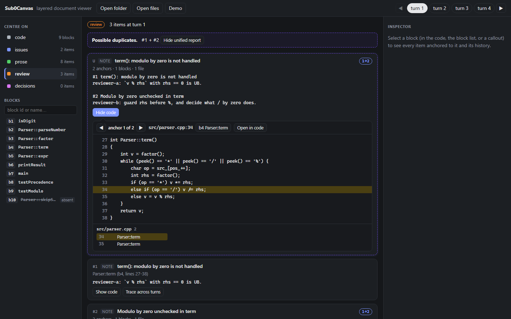

# Sub0Canvas

A viewer for the **layered document** that [Sub0Squad](https://github.com/CraigHutchinson/Sub0Squad)'s canvas worker produces: one canvas seen through any number of layers
(code, gate issues, review notes, prose per function, decisions, or anything else). Each layer binds to **stable block ids**, never to line
numbers. Lines are resolved only when the view renders.

It is a static web app with no build step and no dependencies. Open `index.html`, then open an attempt directory, drop its files on the page, or load
the demo.


## What you can do with it

| | |
|---|---|
| **Centre on any layer** | The left rail lists `code` plus every key of the turn file's `layers` object. The set is not hard-coded, so a new layer appears without a code change. |
| **Prose → code** | Every item has a *Show code* callout attached to its card. The callout shows the block the item is anchored to, resolved to that turn's lines. |
| **Code → layers** | Select a block (in the code, the block list or a callout). The inspector lists every item in every layer anchored to it, including items that still name a block merged into it. |
| **A block's history** | For each turn: what happened to the id (added, kept, renamed, resigned, merged, retired, revived), the canvas revisions that touched its file, whether its text changed, and which layers had items on it. |
| **1-N items** | One item can have many anchors across blocks and files. The card shows the fan-out (`1→8`). The callout steps through the anchors (◀ ▶ or `[` `]`) and groups them by file. |
| **Batch fixes** | An item with a `fix` (a regex) previews the change at every anchored line. The viewer only previews it. The producer applies it. |
| **Duplicates → one report** | Items in a layer that look like the same finding (same kind, similar title, a block in common) are flagged. *Preview unified report* merges them into one item with the union of their anchors. |
| **Trace an item** | Follow one item through the turns: when it appeared, how its anchors moved, and when it went away (fixed). |

Every view is a URL hash (`#turn=3&centre=prose&block=b2&item=prose%23prose-isdigit`), so a view can be linked or reloaded. `,` and `.` step through turns.

### Prose → code


### Code → layers, and the history of a block

`parseNumber` (b2) at turn 3. The block was renamed from `number` at turn 2, then absorbed `isDigit` (b1) in the turn 3 rewrite, so the isDigit
prose now lands here.


### Orphans and duplicates




## Input: `layered-doc-1`

The viewer reads what Sub0Squad's canvas writes in each attempt directory (`<home>/state/workflows/w-*/items/<item>/attempt-N/`):

```
layers/turn-N.json      one snapshot per turn
canvas.json             the revision log  {"files":{path:rev},"log":[{path,by,revision,base,from,to,delta}]}
canvas/<flat>.r<N>      every revision's text ('/' in the path flattened to '_')
```

```jsonc
{"schema":"layered-doc-1","turn":3,
 "files":{"src/parser.cpp":{"revision":5,"text":"..."}},
 "blocks":[{"id":"b2","path":"src/parser.cpp","name":"Parser::parseNumber","signature":"int Parser::parseNumber()","first":42,"last":47}],
 "retired":[{"id":"b1","path":"src/parser.cpp","name":"isDigit","mergedInto":"b2"}],          // "" = its items are orphans
 "events":[{"carry":"merged","id":"b1","path":"src/parser.cpp","name":"isDigit","detail":"b2"}], // since the previous turn
 "layers":{"issues":[{"number":1,"kind":"warning","title":"...","detail":"...",
                      "anchors":[{"blockId":"b4","path":"src/parser.cpp","line":18,"confidence":"exact"}]}]}}
```

You can open a whole workflow folder. Each directory that holds `layers/turn-N.json` becomes its own document, and you pick one from the drop-down.
Loose turn files (dropped without their folders) also load. Malformed files are listed at the top of the page instead of stopping the load.

### Optional fields the viewer understands

These fields are not yet in the producer. The demo uses them, and the viewer works without them:

| Field | Where | Purpose |
|---|---|---|
| `id` | layer item | A stable item identity across turns. It enables *Trace across turns* and merge bookkeeping. Without it, items are matched by kind and title. |
| `column` | anchor | Keeps several sites on one line apart (three `peek()` calls in one `while`). |
| `fix` | item, or an anchor to override the item's | `{"kind":"regex","pattern","replacement","flags","summary"}`: a proposed fix to apply at every anchor. |
| `mergedFrom` | item | The item keys a unified report was built from. |

## Development

```bash
npm test             # node:test, no dependencies (Node 20+)
npm run fixtures     # regenerate fixtures/demo and fixtures/demo.js from tools/gen-fixtures.mjs
npm run serve        # http://127.0.0.1:8765 (only needed where a browser refuses scripts from file://)
node tools/screenshots.mjs   # regenerate docs/screenshots with headless Edge or Chrome
```

| Path | What it is |
|---|---|
| `src/model.js` | Pure model: loading, validation, a per-turn index (live and retired blocks, anchors keyed by the block they *resolve* to through merges), and the queries (`attachedTo`, `fanOut`, `blockHistory`, `itemTrace`, `duplicateGroups`, `unify`, `previewFix`). It is a classic script and a CommonJS module, so the page and the tests load the same file. |
| `src/view.js` | The page: plain DOM, re-rendered from one state object kept in the URL hash. |
| `tools/gen-fixtures.mjs` | The demo story in four turns, with block lines computed from the source text: a SYMBOL edit, a batch regex fix, a rename, a whole-file rewrite with a signature change, a merge, an orphan, a revival, a 1-N issue (8 anchors, 2 files), duplicate review notes, and prose and decision layers. |
| `test/` | Model tests against the demo, plus a check that the committed fixtures match the generator. |

The page uses classic scripts, not ES modules, so it runs when opened straight from disk. The demo is bundled into `fixtures/demo.js` for the same reason.
